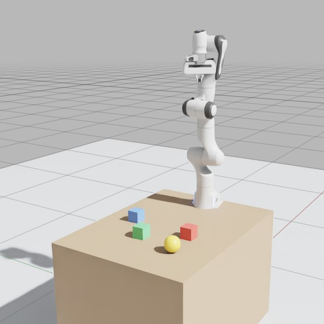
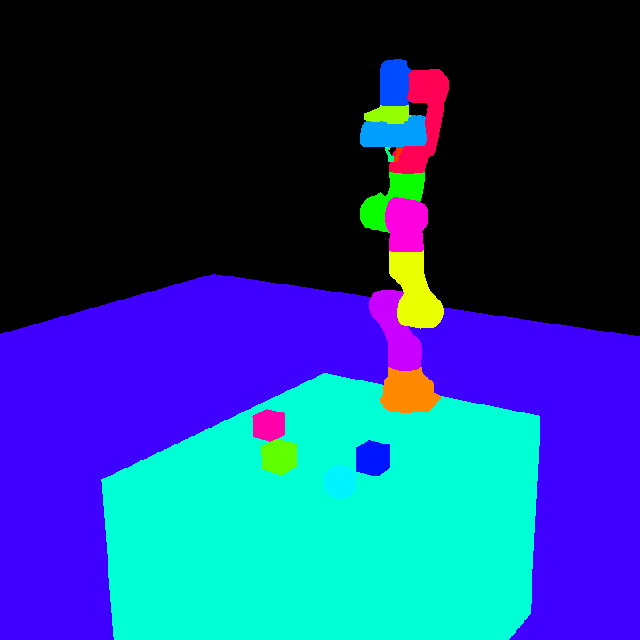
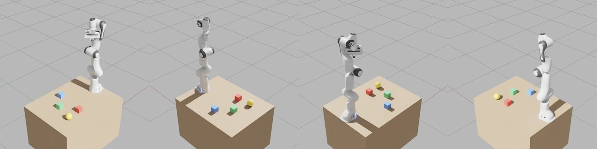

<p align="center">
  
</p>

<h1 align="center">Omniverse MCP</h1>

<p align="center">
  Let an AI assistant work in NVIDIA Isaac Sim and other Omniverse Kit apps:<br>
  look at the scene, edit it, run physics, drive robots and record what happens.
</p>

<p align="center">
  <a href="https://pypi.org/project/omniverse-mcp/"></a>
  <a href="https://pypi.org/project/omniverse-mcp/"></a>
  <a href="https://github.com/astral-sh/uv"></a>
  <a href="https://github.com/serionist/omniverse-mcp/actions/workflows/ci.yml"></a>
  <a href="https://github.com/serionist/omniverse-mcp/actions/workflows/codeql.yml"></a>
  <a href="LICENSE"></a>
</p>

<!-- The official MCP registry trusts the PyPI package by this line, as server.json names it. -->
<!-- mcp-name: io.github.serionist/omniverse-mcp -->

<p align="center">
  
  
</p>
<p align="center">
  <sub>One <code>capture_viewport</code> call in Isaac Sim 6.2: the frame, and every object in its own colour, with the
  legend and the screen boxes that tell the assistant what it sees.</sub>
</p>

Omniverse MCP connects an AI client, such as Claude Code, Cursor or VS Code, to a running Kit app. It comes in two
parts, from one release:

- **the server,** `omniverse-mcp`: the [MCP](https://modelcontextprotocol.io/) server your AI client starts, from
  PyPI;
- **the bridge,** `ovmcp.bridge`: the Kit extension inside the Kit app, listed in Kit as *Omniverse MCP Bridge*.

Claude Code users get both from one plugin, with skills for each kind of work.

```
AI client  --MCP, stdio-->  omniverse-mcp  --HTTP, with a token-->  ovmcp.bridge
                            (the server)                         (inside the Kit app, port 8211)
```

## Requirements

- **A Kit app of Kit 107 or later,** on Windows or Linux. Tested on Isaac Sim 6.2; Isaac Sim 5.x, USD Composer and
  other Kit apps should work, but are untested.
- **[uv](https://docs.astral.sh/uv/getting-started/installation/),** which runs the server. Install it, then open a
  new terminal and restart your AI client, so both find `uvx`:
  - macOS and Linux: `curl -LsSf https://astral.sh/uv/install.sh | sh`
  - Windows: `powershell -ExecutionPolicy ByPass -c "irm https://astral.sh/uv/install.ps1 | iex"`
- **An MCP client that can read files:** the tools write images and long answers to files and return their paths.
- **Kit and the client on the same machine,** or see [Kit on another machine](docs/SETUP.md#kit-on-another-machine).

## Install

### Claude Code: the plugin

In Claude Code:

```
/plugin marketplace add serionist/omniverse-mcp
/plugin install omniverse-mcp@omniverse-mcp
```

If it asks you to, run `/reload-plugins`. From a terminal, the same is `claude plugin marketplace add
serionist/omniverse-mcp`, then `claude plugin install omniverse-mcp@omniverse-mcp`, and the plugin loads when
Claude Code next starts.

Then run `/omniverse-mcp:setup`. It installs the bridge of the plugin's release, tells you what to click in Kit, and
checks the connection. The plugin also brings skills for scenes, geometry, simulation and scripts, which Claude uses
when a request fits ([the plugin](plugin/README.md)).

### Other MCP clients

1. **Install the bridge:**

   ```
   uvx omniverse-mcp extension install
   ```

   It copies `ovmcp.bridge` into your user data folder, then prints the folder Kit needs, under "Kit finds it once
   its extension search paths hold this folder".
2. **Turn it on in the Kit app,** once:
   1. **Window > Extensions**, the menu (☰) at the top right, **Settings**.
   2. Under **Extension Search Paths**, the green **+**, then paste the folder. The **+** adds an empty row: click it
      to type.
   3. Search for `ovmcp` under **THIRD PARTY**, and turn **Omniverse MCP Bridge** on, with **Autoload**.

   The bridge starts at once, and Kit's console shows `[ext: ovmcp.bridge-<version>] startup`. Kit saves the search
   path and Autoload when it exits, so quit it once with **File > Exit**. A headless Kit takes
   `--ext-folder <that folder> --enable ovmcp.bridge` instead ([headless Kit](docs/SETUP.md#headless-kit)).
3. **Add the server to your client's MCP config,** and restart the client. In most clients' JSON:

   ```json
   {
     "mcpServers": {
       "omniverse": { "command": "uvx", "args": ["omniverse-mcp"], "env": { "PYTHONPATH": "" } }
     }
   }
   ```

   Each client's file and form, VS Code's and Codex's included, are in [MCP clients](docs/SETUP.md#mcp-clients). The
   empty `PYTHONPATH` keeps a Python path that Isaac Sim's environment sets out of the server's Python.

Your client gets the server's short instructions with it. If it ignores them, see
[docs/AI_GUIDE.md](docs/AI_GUIDE.md), which also points at the plugin's skills as plain Markdown files.

### Check that it works

With the Kit app running, ask your assistant to *"call get_sim_state"*. It answers with lines such as:

```
state = stopped
up_axis = Z
...
extension_version = 0.2.2
server_version = 0.2.2
```

Something else? See [Troubleshooting](#troubleshooting).

> **Used the extension before 0.2.0?** It came from a clone of this repo, and before that it was
> `isaacsim.mcp.bridge`. Turn the old one off and remove its search path, so Kit loads one copy. See the
> [changelog](CHANGELOG.md).

## What you can ask

> "What's in the scene? Capture the viewport and tell me where each object is."

> "Put a table at the origin with a red, a green and a blue cube on it, and light it so the capture isn't black."

> "Show me /World/Table from its four top corners, with everything else hidden."

> "How many faces does /World/Robot have, and which parts have the most?"

> "Add a Franka arm on the table, and list its joints and their limits."

> "Drop a cube from one metre, record two seconds of it falling, and show me the last frame."

> "Export /World/Table as a self-contained USD file."

> "That failed. Show me Kit's warnings and errors."

## The tools

| Area | Tools | What they do |
|---|---|---|
| **Scene** | `get_scene_tree`, `dump_scene`, `get_prim_properties`, `get_prim_bounds`, `set_prim_transform`, `create_prim`, `delete_prim`, `clone_prim`, `set_visibility`, `save_scene`, `new_scene` | Read the scene's hierarchy and properties; create, move, copy, hide and delete objects; save, or start an empty scene |
| **Camera** | `capture_viewport`, `inspect_prim`, `set_camera`, `look_at_prim`, `viewport_light` | Capture the viewport with each object's screen box and colour, see one object from several sides, aim the camera, light the view |
| **Materials** | `set_material`, `update_material_paths` | Give an object a colour and surface; fix material paths after files move |
| **Simulation** | `sim_control`, `get_sim_state` | Play, pause, stop and step physics; the state, the up axis and the versions |
| **Physics** | `set_physics_properties`, `apply_force`, `raycast` | Mass, friction and bounce; push an object; cast a ray |
| **Robots** | `create_robot`, `get_robot_info`, `get_joint_states`, `set_joint_targets` | Add a robot from Isaac Sim's library (Franka, UR10, G1, Spot and more), read its joints, set joint targets |
| **Recording** | `start_recording`, `stop_recording`, `get_recording_frame` | Record frames and objects' state while physics plays, then look back at any frame |
| **Geometry** | `get_mesh_stats`, `get_prim_face_count_tree`, `compare_prims` | Count faces and vertices, find the heaviest parts, compare two objects or variants |
| **USD files and variants** | `flatten_usd`, `export_prim_as_file`, `create_variant_structure`, `set_variant_selection` | Write a stage as one file, export an object, make and switch variant sets |
| **Kit** | `get_logs`, `manage_extensions`, `draw_debug` | Read Kit's log, turn Kit extensions on and off, draw lines and points in the viewport |
| **Scripts** | `execute_script` | Run Python inside Kit for anything the other tools don't do |

Every tool, with its parameters, is in the [tool reference](docs/TOOLS.md).

<p align="center">
  
</p>
<p align="center">
  <sub><code>inspect_prim(prim_path="/World/Workcell", angles=["top_front_right", "top_back_right", "top_back_left",
  "top_front_left"], isolate=True)</code>: one call, every side, framed to fit, the rest of the scene hidden.</sub>
</p>

## Updating

The server and the bridge come from one release, so update them together, then restart Kit and your client.

- **The plugin:** `claude plugin marketplace update omniverse-mcp`, then
  `claude plugin update omniverse-mcp@omniverse-mcp`, and restart Claude Code. Then run `/omniverse-mcp:setup`, which
  installs the matching bridge.
- **Other clients:** `uvx omniverse-mcp@latest extension install` fetches the newest server and installs its bridge.
  On Windows a running Kit holds the bridge's folder: quit it first. Unpinned, uvx can also move to a new release
  by itself; the server then names the command that installs the matching bridge. To stay on one release, pin it
  ([Updating](docs/SETUP.md#updating)).

## Configuration

### The server

```
omniverse-mcp [--host HOST] [--port PORT] [--output-dir DIR]    the MCP server, over stdio
omniverse-mcp extension install                                 install the bridge of this release
omniverse-mcp extension path                                    print the folder Kit's search paths need
```

| Variable | Flag | Default | What |
|---|---|---|---|
| `OMNIVERSE_MCP_HOST` | `--host` | `127.0.0.1` | where the bridge listens |
| `OMNIVERSE_MCP_PORT` | `--port` | `8211` | the bridge's port |
| `OMNIVERSE_MCP_OUTPUT_DIR` | `--output-dir` | `mcp_output` in the working folder | where images and long answers go |
| `OMNIVERSE_MCP_TOKEN` | | the token file | the bridge token, for a Kit app on another machine |
| `OMNIVERSE_MCP_STATE_DIR` | | per system | the token file's folder, set the same on both sides |

The plugin's server reads them from the environment Claude Code starts in. Add `mcp_output/` to your project's
`.gitignore`.

### The bridge

| Setting | Default | What |
|---|---|---|
| `/exts/ovmcp.bridge/host` | `127.0.0.1` | the address it listens on |
| `/exts/ovmcp.bridge/port` | `8211` | its port |
| `/exts/ovmcp.bridge/token` | empty: a new token at every start | a fixed token, for a remote MCP server |

Set them on Kit's command line, such as `--/exts/ovmcp.bridge/port=8212`, and give the server the same port in
`OMNIVERSE_MCP_PORT`. Don't edit the installed extension's `extension.toml`: the next `extension install` replaces it.

### The bridge token

The bridge runs any Python the server sends, so it answers only a server that holds its token. At every start it
writes a new token to a file only your user can read, and the server on the same machine reads it: nothing to set up.
Requests from web pages are refused. [Kit on another machine](docs/SETUP.md#kit-on-another-machine) says how to set a
token by hand, and [Architecture](docs/ARCHITECTURE.md#the-bridge-token) where the file lives.

### Context7 for scripts

Models are not trained on Omniverse and Isaac Sim APIs, and guess their names. With [Context7](https://context7.com)
as a second MCP server, the assistant looks the API up (library `isaac-sim/isaacsim`) before writing `execute_script`
code; the server's instructions and the `script` skill ask it to.

## Troubleshooting

**"Missing or wrong bridge token"**: Kit runs as another user, in a container or on another machine. Set a token by
hand ([Kit on another machine](docs/SETUP.md#kit-on-another-machine)).

**"The Kit extension is older than this MCP server", or "speaks bridge protocol"**: the server and the bridge come
from different releases. Run the command the message names, then restart Kit.

**"Kit app connection failed", refused or timed out**: is the Kit app running, with the bridge on? Its console shows
`[ext: ovmcp.bridge-<version>] startup`. The server looks on port 8211 unless `OMNIVERSE_MCP_PORT` says otherwise. On
its first start Isaac Sim compiles shaders for several minutes, and answers slowly until then.

**Kit logs `[MCP Bridge] Failed to start server`**: another program, or a second Kit app, holds port 8211. Give this
Kit app another port, and the server the same one ([The bridge](#the-bridge)).

**The server doesn't start**: Claude Code's `/mcp` shows its error; other clients have an MCP log. Is `uvx` on the
PATH the client starts with? Restart the client after installing uv.

**A capture comes back black**: the answer says so, with the lighting mode. `viewport_light(action="set",
mode="Default")` lights the view, or `mode="camera"` for a light that follows the camera; Kit apps have no default
light.

**A tool returns an error**: `get_logs(min_level="warn")` shows what Kit reported. `get_joint_states` needs physics
playing or paused, and `raycast` needs it to have played once; the robot tools need Isaac Sim.

More in [SETUP.md](docs/SETUP.md#troubleshooting).

## Known issues

On Isaac Sim 6.2, the only Kit app tested so far:

- **`apply_force` refuses an articulation's links,** such as a robot's: PhysX's push doesn't reach them yet
  ([#58](https://github.com/serionist/omniverse-mcp/issues/58)).
- **`capture_viewport` and `inspect_prim` return the image at the viewport's size,** while their boxes use the size
  asked for ([#51](https://github.com/serionist/omniverse-mcp/issues/51)).
- **`draw_debug`'s fallback for Kit apps without Isaac Sim's debug drawing** can miss a capture
  ([#57](https://github.com/serionist/omniverse-mcp/issues/57)).
- **Some parameters are ignored:** `start_recording`'s camera and size: it records the active viewport at its own
  size, and warns when it is given them
  ([#25](https://github.com/serionist/omniverse-mcp/issues/25)).

## Security

The bridge runs any Python the server sends, by design: `execute_script` is a tool. The token keeps other programs
and web pages out, but not your own AI client, so keep it asking before `execute_script` and `manage_extensions`.
Report a vulnerability privately, as [SECURITY.md](SECURITY.md) says.

## Documentation

- [Setup in depth](docs/SETUP.md): each client's config, headless Kit, ports, remote setups, uninstalling
- [Tool reference](docs/TOOLS.md): every tool, its parameters and hints
- [The plugin](plugin/README.md): what the Claude Code plugin brings, and its skills
- [Without the plugin](docs/AI_GUIDE.md): the context and workflows for other clients
- [Architecture](docs/ARCHITECTURE.md): how the server and the bridge work, for contributors
- [Changelog](CHANGELOG.md), [Security](SECURITY.md), [Contributing](CONTRIBUTING.md)

Until 1.0, a minor release can change the tools; the changelog lists it under Breaking. Questions, ideas and bugs:
[open an issue](https://github.com/serionist/omniverse-mcp/issues/new/choose).

## Licence

[MIT](LICENSE). Not affiliated with or endorsed by NVIDIA; Omniverse and Isaac Sim are NVIDIA's trademarks.
